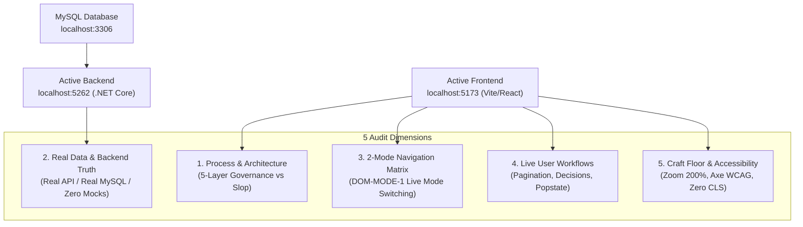

# Live Web Runtime Conformance Audit Design

**Date:** 2026-10-18  
**Status:** Proposed for Owner Approval  
**Scope:** Live Web Runtime Conformance Audit across Running Frontend (`http://127.0.0.1:5173`) and Backend (`http://127.0.0.1:5262`), Deep Architecture vs Cosmetic Patching Evaluation, 2-Mode Live Operational Verification (`DOM-MODE-1`), and Real Database Authentication  
**State Owner:** `.planning/WORK.md`  
**Parent Spec:** `docs/superpowers/specs/2026-10-17-requirements-to-runtime-conformance-design.md`

---

## 1. Intent & The "Why"

This design addresses the critical question posed by the project owner:
> **"Kiểm tra trực tiếp trên web để kiểm chứng cả các công việc tạo lại FE cho dự án đang hoạt động đã đúng quy trình chưa, cũng như các yêu cầu đã đủ hay chỉ đang chắp vá?"**  
> *(Test directly on the web to verify whether the FE recreation work for the active project followed the correct process, and whether requirements are fully satisfied or merely cosmetically patched?)*

A purely static or unit-test-green status is insufficient to answer this. A system can appear green while hiding superficial workarounds, disconnected forms, or brittle mock bridges.

This audit establishes a rigorous live evaluation protocol directly against the active servers:
1. **Real Network Handshake:** Connect live browser instances to the real running ASP.NET Core API (`http://127.0.0.1:5262`) and MySQL database (`port 3306`), proving real JWT authentication without client-side mock shortcuts.
2. **Process Integrity vs Cosmetic Patching:** Trace each of the 14 routes from Layer 1 requirements down to live DOM elements to determine if the 3-Zone Flat Workbench was built through genuine component architecture or superficial styling hacks.
3. **2-Mode Live Operational Verification (`DOM-MODE-1`):** Verify live mode switching between `DEFAULT` and `MATERIAL_RECONCILIATION`, ensuring strict isolation of commands and proper disabling of invalid state transitions.
4. **Primary Work Object vs Sub-Tab Navigation Audit:** Audit the live navigation hierarchy to ensure that independent business entities reside on the N6 Sidebar tree while local filters stay inside the views.
5. **Real User Interactive Workflows:** Exercise live data grids, server pagination, modal confirmations with mandatory reasons, and browser history popstate traps.

---

## 2. The 5 Dimensions of the Live Audit

### Dimension 1: Process & Architecture Integrity (Kiến trúc chuẩn vs Chắp vá)
- **Check:** Does every route conform to the 3-Zone Flat Workbench?
  - Zone 1: `WorkspaceHeader` ($56px \pm 1px$, title, context selector, single primary button $D7$).
  - Zone 2: `TelemetrySubbar` ($44px \pm 1px$, inline telemetry with font `tabular-nums`, zero 120px KPI cards).
  - Zone 3: `DataGrid` / `SplitView` ($85\%$ viewport height, compact density 36–40px $T8$, frozen sticky header $T7$).
- **Check:** Are 100% of the UI components from `docs/UI-KIT.md`? Are there zero custom primitive inventions (no BadgeV2, TableCustom) and zero ad-hoc CSS classes or inline styles outside `index.css`?

### Dimension 2: Real Data Flow & Backend Authority
- **Check:** Does `/api/auth/login` authenticate with real database credentials (`admin`, `beptruong`, `thukho`, `thumua`, `dieuphoi`, `quanly` with password `Admin@123456`)?
- **Check:** Are API responses from `/api/ingredients`, `/api/dishes`, `/api/coordination/orders`, `/api/purchase-orders`, `/api/inventory-issues` returning real persisted database rows rather than fallback arrays?
- **Check:** Does `ZeroFakeApiAndTestAuditGuard` guarantee that `src/api/*.ts` has zero mock fallback functions?

### Dimension 3: 2-Mode Live Operational Verification (`DOM-MODE-1`)
- **Check:** In `DEFAULT` mode:
  - Can users access standard operational routes (`/weekly-menu`, `/purchasing`, `/warehouse`, `/chef`)?
  - On `/reconciliation`, is the "Chốt đối soát ca" button disabled with an explicit fieldset explaining mode restriction?
- **Check:** When switched to `MATERIAL_RECONCILIATION` via `/settings/advanced?view=mode`:
  - Does the header and sidebar reflect the active MRX mode badge?
  - Does the completion button on `/reconciliation` become enabled when conditions are met?

### Dimension 4: Primary Work Object vs Sub-Tab Navigation Audit
- **Check:** Are primary business work objects accessible as URL-owned leaves on the Sidebar v2 (`Rule N6`)?
  - Weekly Menu: `/weekly-menu` (schedule), `/weekly-menu?view=demand`, `/weekly-menu?view=production-plan`, `/weekly-menu?view=cost`.
  - Warehouse: `/warehouse?view=issues`, `/warehouse?view=receipts`, `/warehouse?view=stock`.
  - Chef: `/chef?view=plans`, `/chef?view=issues`.
  - Reports: `/reports?view=demand`, `/reports?view=prices`, `/reports?view=stock`.
  - Admin: `/admin-data?view=ingredients`, `/admin-data?view=dishes`.
- **Check:** Are in-page tabs strictly reserved for local facets and filters (e.g. status filters, shift tabs)?

### Dimension 5: Live Interactive Workflows & A11y Craft Floor
- **Check:** Does clicking the browser Back button while a form draft is dirty trigger the `alertdialog` "Hủy thay đổi chưa lưu?" without losing data?
- **Check:** Does clicking pagination buttons ("Trang sau", "Trang trước") query the server with explicit page parameters and update the grid cleanly?
- **Check:** Does Zoom 200% scale the viewport cleanly without clipping Vietnamese diacritics or breaking table containers?

---

## 3. The Live Verification Protocol

The live audit will be executed via an automated Playwright suite (`live-conformance-audit.spec.ts`) connecting directly to the running server at `http://127.0.0.1:5173`:
1. **Live Auth Test**: Submit real login request via UI form, verify token receipt and localStorage session storage.
2. **Live Route Traversal**: Navigate to each of the 14 routes as an authenticated user, inspect DOM heights and component trees.
3. **Live Mode Transition**: Submit PUT request to change mode from `DEFAULT` to `MATERIAL_RECONCILIATION` with optimistic concurrency version check, verify UI state change.
4. **Live Popstate Trap**: Trigger dirty state on a modal, dispatch `popstate`, verify alertdialog visibility.
5. **Live Evidence Report**: Produce an evidence table detailing the verdict for each dimension (GENUINE vs PATCHED).

---

## 4. Acceptance Criteria for the Audit

| Criterion | Genuine Process (PASS) | Cosmetic Patching (FAIL) |
|---|---|---|
| **API Integration** | Connects to real HTTP endpoint, returns server DTO, throws on 500/502 | Catches error and returns hardcoded array |
| **Component Kit** | Uses `WorkspaceHeader`, `TelemetrySubbar`, `DataGrid`, `StateBoundary` | Inlines custom div wrappers, tables, or cards |
| **Layout Geometry** | Header is exactly 56px, Subbar is exactly 44px, table headers sticky | Heights vary randomly, no sticky headers |
| **Data Authority** | Dates and prices computed from DTO facts | Hardcoded strings ("25.000 ₫", "21/09/2026") |
| **Mode Isolation** | ActionGuard checks mode, disabled in DEFAULT mode | Action visible or clickable regardless of mode |
| **Draft Protection** | Popstate and beforeunload prompt user before discarding draft | Page navigates away immediately, losing draft |
