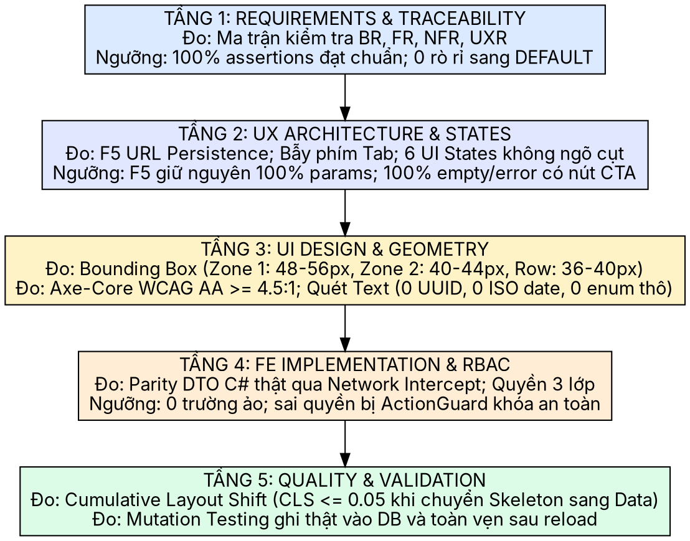

# Đặc Tả Kỹ Thuật: Quy Chuẩn Đo Kiểm Định Lượng 5 Tầng Phân Hệ MRX (5-Layer Empirical Measurement Design)

**Dự án:** [Peaker04/IPCManagement (`feature/greenfield-fe-3zone-workbench`)](https://github.com/Peaker04/IPCManagement/tree/feature/greenfield-fe-3zone-workbench)  
**Ngày lập:** 2026-10-24  
**Chủ đề:** Chuyển đổi toàn diện từ "chụp ảnh bề mặt" sang "Đo kiểm định lượng 5 tầng kiến trúc quản trị (5-Layer Empirical Measurement)" trên toàn bộ 7 Route của chế độ Đối soát nguyên liệu (MRX), sử dụng các công cụ đo đạc hình học, trợ năng, mạng và hiệu năng không phụ thuộc vào output console.

---

## 1. Mục Tiêu & Ranh Giới Kiểm Toán Định Lượng

Kiểm toán định lượng 5 tầng loại bỏ hoàn toàn hiện tượng "ảo giác pass" hoặc "chạy nhanh bỏ qua lỗi". Bất kỳ Route nào được tuyên bố hoàn tất đều phải xuất trình được **Hồ sơ Đo Kiểm Chứng 5 Tầng (5-Layer Measurement Dossier)** với số liệu đo thực tế trên trình duyệt Chromium thật:

---

## 2. Tiêu Chuẩn Kỹ Thuật Định Lượng Chi Tiết Từng Tầng (Quantified Criteria)

### Tầng 1: Requirements & Business Rules Layer
* **`BR-GLOBAL-01` (Mode Isolation):** Kiểm tra request mạng; cấm mọi request tới các API của DEFAULT (`/api/purchase-workflow`, `/api/material-demand`, `/api/approvals`). Thử mở các route DEFAULT phải chuyển hướng an toàn về `/forbidden`.
* **`BR-GLOBAL-03` (Ledger Immutability):** Các bản ghi lô đã chốt (`COMPLETED`) hoặc phiếu kho đã ghi sổ (`POSTED`) phải chuyển sang trạng thái chỉ đọc, không có nút mutation hoạt động.
* **`BR-GLOBAL-04` / `UXR-02` (Explicit Blocker Evidence):** Khi một thao tác bị chặn (ví dụ: tuần chưa thể chốt sổ), giao diện bắt buộc phải có thẻ cảnh báo (`ReconciliationBlockerStrip` / alert) giải thích nguyên nhân và nút shortcut dẫn đường.

### Tầng 2: UX Architecture & Interaction Layer
* **URL State Persistence:** Khi người dùng thay đổi bộ chọn (`batchId`, `date`, `customerId`, `view`), URL searchParams phải cập nhật tức thì. Khi F5 reload trang, 100% các giá trị này phải được đọc lại từ URL để phục hồi đúng trạng thái.
* **Modal Accessibility (WCAG 2.2 AA):** Khi mở bất kỳ `Modal` hoặc `Dialog` nào, phím Tab phải bị bẫy bên trong modal (không thoát ra ngoài nền sau); phím Escape phải đóng modal; khi đóng phải khôi phục focus về đúng nút đã kích hoạt.
* **Zero Dead-End Guarantee:** 100% các màn hình ở trạng thái Trống (`EmptyState`) và Lỗi (`QueryErrorAlert`) bắt buộc phải có nút bấm hành động tiếp theo (CTA) hoặc nút `[Thử lại]`.

### Tầng 3: UI Design, Geometry & Visual Layer
* **Bounding Box Geometry Measurement:** Đo đạc bằng `Element.getBoundingClientRect()`:
  - **Zone 1 (`WorkspaceHeader`):** Chiều cao thực tế nằm trong ngưỡng **$48\text{px} \le h \le 56\text{px}$**.
  - **Zone 2 (`TelemetrySubbar`):** Chiều cao thực tế nằm trong ngưỡng **$40\text{px} \le h \le 44\text{px}$**.
  - **Zone 3 Data Row (`Rule T8`):** Chiều cao từng dòng dữ liệu trong bảng nằm trong ngưỡng **$36\text{px} \le h \le 40\text{px}$** (dòng thường) và $\le 44\text{px}$ (dòng có ô nhập liệu).
* **Color Contrast Measurement (Axe-Core):**
  - Chạy `@axe-core/playwright` quét toàn trang: tỷ lệ tương phản chữ/nền phải đạt chuẩn **WCAG 2.1 AA ($\ge 4.5:1$)**.
* **Text Hygiene Scan:**
  - Quét toàn bộ DOM văn bản của trang:
    - **0 chuỗi UUID thô** (chuỗi 32–36 ký tự hex dạng `[0-9a-f]{8}-[0-9a-f]{4}-...`).
    - **0 chuỗi ngày ISO thô** (`\d{4}-\d{2}-\d{2}` không qua định dạng Việt Nam).
    - **0 enum kỹ thuật tiếng Anh chưa ánh xạ** (`MATCHED`, `UNDER_ISSUED`, `OVER_ISSUED`, `NULL`).

### Tầng 4: FE Implementation & RBAC Layer
* **DTO Schema Parity:**
  - Chặn bắt request/response mạng: Dữ liệu nạp lên bảng phải khớp 100% với C# Backend DTO (`ReconciliationBatchDto`, `ReconciliationWarehouseDailyDto`, `PagedResponseDto<T>`).
  - Tuyệt đối không chứa các trường dữ liệu tự chế hoặc fallback giả định.
* **Three-Tier RBAC Verification:**
  - Thử nghiệm đăng nhập bằng tài khoản không có quyền: Các nút bấm mutation phải bị ẩn hoặc bọc qua `<fieldset disabled>` có giải thích lý do rõ ràng.

### Tầng 5: Quality & Performance Validation Layer
* **Cumulative Layout Shift (CLS) Measurement:**
  - Đo bằng `PerformanceObserver` trong lúc skeleton chuyển sang dữ liệu thật: **$\text{CLS} \le 0.05$**.
* **Full Mutation Cycle Verification:**
  - Mọi thao tác ghi dữ liệu (Xuất kho, Bổ sung, Giải trình, Chốt tuần) phải được kiểm chứng bằng việc ghi thật vào cơ sở dữ liệu và khôi phục trạng thái toàn vẹn sau khi reload F5.

---

## 3. Danh Mục 7 Route Đo Kiểm & Cấu Trúc Báo Cáo Xuất Xưởng

Mỗi Route trong 7 Route sau đây sẽ sinh ra một thư mục hồ sơ riêng biệt tại `.artifacts/5layer-audits/<route-id>/`:

1. **`route1-login`**: `/login` (Khởi động phiên & phân luồng landing theo vai trò).
2. **`route2-mrx-batch`**: `/weekly-menu?view=mrx-batch` (Điều phối: Nhập Excel, Tạo lô, Đóng băng, Chuyển Kho).
3. **`route3-warehouse-daily`**: `/warehouse?view=mrx-daily` (Kho 1: Định lượng xuất ngày & Xuất bổ sung ca).
4. **`route4-warehouse-preparation`**: `/warehouse?view=mrx-preparation` (Kho 2: Xuất phối hợp đa khách hàng).
5. **`route5-warehouse-issues`**: `/warehouse?view=mrx-issues` (Kho 3: Hàng đợi thay đổi nguồn & Delta).
6. **`route6-chef-cooking`**: `/chef?view=mrx-cooking` (Bếp trưởng: Thẻ nấu món ăn, In A4, Pure Read-Only).
7. **`route7-reconciliation`**: `/reconciliation` (Quản lý: Control Tower, Rà soát chênh lệch 2 chiều, Chốt sổ tuần).

Tệp `5LAYER-AUDIT-DOSSIER.md` trong mỗi thư mục sẽ ghi nhận:
- Bảng số liệu Bounding Box (pixel).
- Bảng kết quả Axe-Core contrast check.
- Bảng đo chỉ số CLS.
- Kết quả quét Text Hygiene (UUID/ISO/Enum).
- Bộ 6 ảnh chụp Retina 2x ứng với 6 trạng thái UI.
